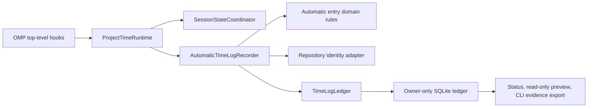

# Evidence Pipeline Architecture

## Purpose

The architecture records automatic Project Time evidence without coupling OMP event handling to SQLite details or downstream billing policy.

## Ownership and Direction

| Owner                                                    | Responsibility                                                                                                 | Depends on                                           |
| -------------------------------------------------------- | -------------------------------------------------------------------------------------------------------------- | ---------------------------------------------------- |
| `src/index.ts` and `src/omp-extension.ts`                | Public extension entrypoint and default activity generator wiring                                              | OMP extension API                                    |
| `src/extension/runtime.ts`                               | Registers OMP hooks and commands; coordinates status, activity generation, state, and recorder calls           | Extension interfaces and application/domain services |
| `src/extension/application/session-state-coordinator.ts` | Owns active-window session-state transitions                                                                   | Domain state                                         |
| `src/time-log/recorder.ts`                               | Converts session settlements and agent turns into automatic-entry inputs; serializes per-session activity work | Git adapter, domain entry creation, ledger           |
| `src/time-log/domain/`                                   | Entry shape, validation, source keys, attribution, and interval rules                                          | Scalar utilities only                                |
| `src/time-log/infrastructure/ledger.ts`                  | Locking, SQLite initialization, owner-only permissions, JSON migration, and serialization                      | Domain parsing and Node/Bun SQLite adapter           |
| `src/infrastructure/git-repository.ts`                   | Produces sanitized repository labels and normalized identity                                                   | Git subprocess boundary                              |
| `src/project-time-cli.ts`                                | Reads the local ledger and writes the public evidence snapshot                                                 | Recorder and snapshot mapper                         |

Dependencies flow from OMP adapters toward domain rules and persistence. The domain does not call OMP, Git, SQLite, or a billing provider.

## Runtime and Language Boundary

OMP loads the compiled ESM extension in Bun. Development tests and the standalone CLI run in Node; the ledger selects the host's built-in SQLite API behind the same statement interface. Source `@/` aliases are rewritten to relative `.js` imports during the build. The [language decision](/docs/decisions/retain-typescript-runtime.md) explains why these shared contracts remain TypeScript rather than introducing a native or subprocess core.

### Agent Run Boundaries

The runtime starts AI evidence at OMP's `agent_start`. Per-turn `turn_end` events settle human-active evidence only. A terminal `agent_end` closes AI evidence; `willContinue: true` retains the open interval across the announced continuation. Run ownership is independent of the expiring human-active status.

An observed `session_shutdown` or completed `session_switch` closes and flushes an unfinished run exactly once at that boundary; neither proves normal completion or meaningful productivity. A new prompt discards an older in-memory run whose terminal event was not observed rather than inventing its end. A crash loses unclosed AI evidence: reads, restarts, and upgrades never extrapolate it or repair the incomplete intervals recorded before 9.4.2.

## Persistence and Migration

The default ledger is `~/.omp/project-time/time-log.sqlite`. The ledger serializes cross-window operations with a file lock, creates the parent directory owner-only, and applies owner-only database permissions. On first access it transactionally imports a valid legacy `time-log.json` file, retaining the original file as a rollback backup. Invalid legacy JSON remains untouched and is not partially imported.

The public `entries` snapshot is intentionally stable across the internal JSON-to-SQLite migration. Consumers receive raw evidence fields rather than SQLite rows.

`TimeLogLedger` owns the managed-file footprint: the SQLite database, present journal/WAL/SHM sidecars, and retained legacy JSON backup. Runtime and CLI statistics consume that global byte count without assigning physical storage to an individual project.

### Migration State and Recovery

The `legacy_json_migration` metadata marker, not the existence of the SQLite file, determines whether the backup has been imported. A failed import can leave a valid empty SQLite schema with no completion marker.

| State | Effective evidence for autocomplete and prune preview | Next importing operation |
| --- | --- | --- |
| No SQLite database | Valid legacy automatic entries, or no entries if the legacy file is absent | Initialize SQLite and transactionally import any valid legacy file |
| SQLite exists, migration unmarked, legacy file present | Validate and preview the pending legacy entries; reject a conflict with existing SQLite entries | Import the same entries and set the marker in one transaction |
| SQLite exists, migration unmarked, legacy file absent | Existing SQLite entries | Continue without importing; do not claim a completed import |
| Migration marked complete | SQLite entries only, even if a backup remains or all imported entries were pruned | Never reimport the retained backup |

Autocomplete and dry-run pruning do not initialize a database, import entries, or rewrite either evidence file. Autocomplete returns no suggestions if the pending input is invalid; prune preview reports the same malformed-input or existing-data conflict as import instead of claiming an empty safe result. A dry run is a snapshot, not a reservation: new evidence recorded before actual pruning can change the counts.

After a failed import, preserve both files and correct the malformed legacy input before retrying. Do not delete SQLite to force recovery: it may already contain evidence. If SQLite already has entries and a legacy import remains pending, automatic merging is intentionally rejected; preserve both sources for explicit operator review. Once migration succeeds, restart older OMP processes so they do not append new evidence to the retained JSON backup.

## Configuration Boundary

Configuration loading validates untrusted plugin configuration before runtime use. The public configuration permits only three scalar settings. Retired repository-billing settings fail explicitly rather than silently changing behavior.

Interactive configuration loads global plugin settings plus working-directory overrides and controls recording and display. The standalone CLI does not load those settings; it inspects or explicitly prunes the home-rooted local ledger. Changing the working directory does not select a different evidence store. An exact `--project NAME` filters persisted evidence, not configuration or storage ownership.

## Sources

- Runtime and command adapters: [`src/extension/runtime.ts`](../../src/extension/runtime.ts), [`src/project-time-cli.ts`](../../src/project-time-cli.ts)
- Recorder and domain: [`src/time-log/recorder.ts`](../../src/time-log/recorder.ts), [`src/time-log/domain/`](../../src/time-log/domain/)
- Ledger: [`src/time-log/infrastructure/ledger.ts`](../../src/time-log/infrastructure/ledger.ts)
- Config parsing: [`src/config/`](../../src/config/)
- Persistence and config tests: [`test/time-log.test.ts`](../../test/time-log.test.ts), [`test/config.test.ts`](../../test/config.test.ts)
- Migration-preview regressions: [/test/ledger-migration-views.test.ts](/test/ledger-migration-views.test.ts)
